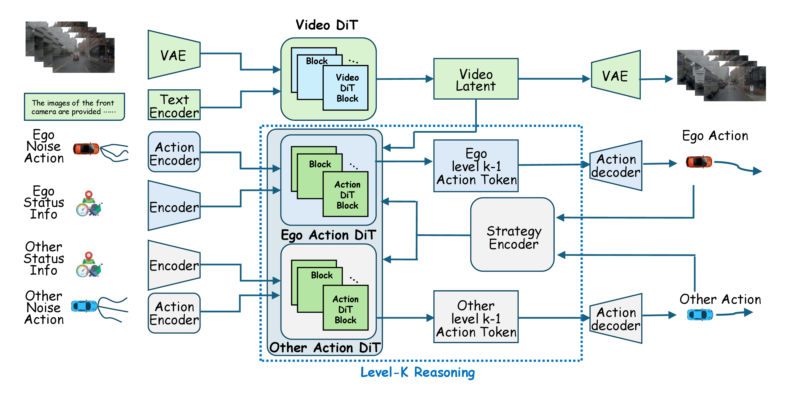
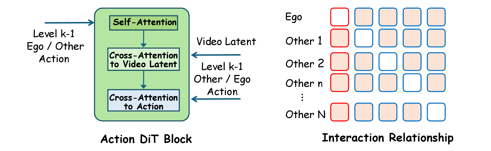
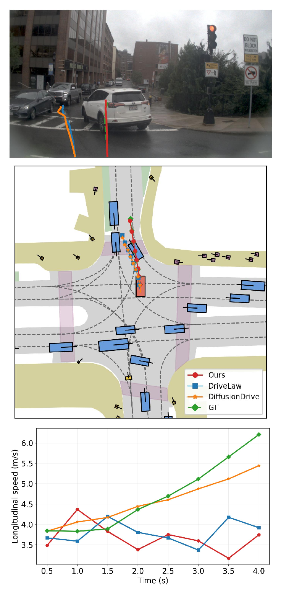
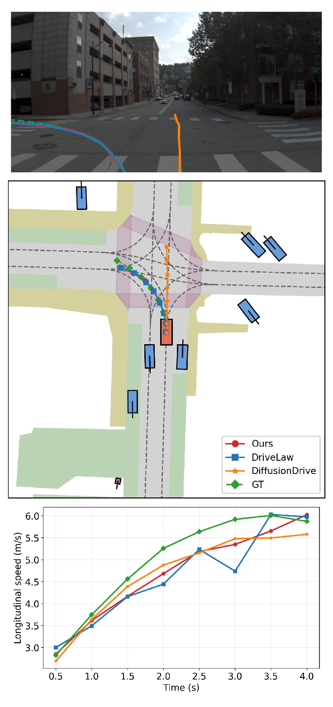
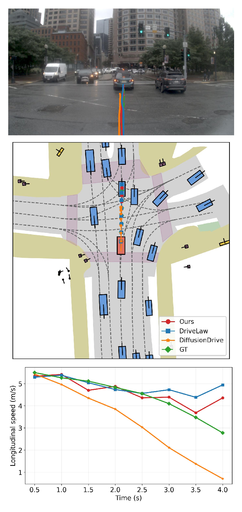

<div align="center">

# ReWAM

### Reciprocal World Action Models for Interactive Autonomous Driving

**Benshan Ma<sup>1</sup> · Pei Liu<sup>1</sup> · Ruiguo Zhong<sup>1</sup> · Lang Zhang<sup>2,*</sup>**<br>
**Mingyue Feng<sup>2</sup> · Yaonong Wang<sup>2</sup> · Jun Ma<sup>1,3,†</sup>**

<sup>1</sup> The Hong Kong University of Science and Technology (Guangzhou)<br>
<sup>2</sup> Leapmotor &nbsp;&nbsp; <sup>3</sup> The Hong Kong University of Science and Technology

<sup>*</sup> Project leader. &nbsp; <sup>†</sup> Corresponding author.

[](https://arxiv.org/abs/2609.39245)
[](https://github.com/LeapWM/rewam)

**Modeling interactive driving as a hierarchy of reciprocal responses.**

</div>

Official inference implementation of [**ReWAM: Reciprocal World Action Models for Interactive Autonomous Driving**](https://arxiv.org/abs/2609.39245).

> **Release scope.** This repository contains the Level-$k$ planner, checkpoint loading, NAVSIM evaluation, submission export, qualitative visualization, and inference-focused tests. Training pipelines, auxiliary-loss implementations, cache builders, mining scripts, gradient calibration, and experiment logs are outside the scope of this release.

[News](#news) · [Overview](#overview) · [Results](#results) · [Release Status](#release-status) · [Getting Started](#getting-started) · [Evaluation](#navtest-evaluation) · [Citation](#citation)

## News

- **2026/10/11:** Released the ReWAM inference code and updated the reference configuration to Level-3 reasoning.
- **2026/09/30:** The ReWAM paper became available on [arXiv](https://arxiv.org/abs/2609.39245).

## Overview

World Action Models ground action generation in a learned representation of the future world. Existing approaches, however, usually treat surrounding vehicles as elements to predict rather than decision-makers whose behavior changes in response to the ego plan.

ReWAM introduces a game-theoretic World Action Model that represents the ego vehicle and surrounding agents as conditional responders. A finite Level-$k$ hierarchy recursively refines their actions while keeping every response grounded in the same predicted future-world representation.

<p align="center">
  <a href="assets/readme/rewam_framework.png">
    
  </a>
  <br>
  <strong>ReWAM framework.</strong> Ego and surrounding-agent policies respond to the preceding-level strategies of the other participants. Click the figure to enlarge.
</p>

### Key ideas

- **Reciprocal action modeling:** ego and surrounding-agent actions are modeled as mutually conditioned responses.
- **World-grounded Level-$k$ reasoning:** every response level is conditioned on shared Video DiT features and preceding-level strategies.
- **Role-specific action experts:** an Ego Action DiT and a parameter-shared Other Action DiT capture different response roles.
- **Cross-agent strategy conditioning:** compact strategy tokens let each participant attend to all other valid participants.
- **Conditional flow matching:** response policies are learned from demonstrations across agents and reasoning levels.

### Level-$k$ interaction block

<p align="center">
  <a href="assets/readme/interaction_block.png">
    
  </a>
</p>

Each Action DiT block combines temporal self-attention over the target action sequence, cross-attention to the shared future-world representation, and cross-agent attention to preceding-level strategy tokens. This captures a finite chain of reciprocal responses without requiring an online multi-agent equilibrium solver.

## Results

ReWAM is trained on the official NAVSIM `navtrain` split and evaluated on `navtest`. All values are multiplied by 100; higher is better.

### NAVSIM benchmark

| Method | NC | DAC | TTC | Comfort | EP | PDMS |
|---|---:|---:|---:|---:|---:|---:|
| DiffusionDrive | 98.2 | 96.2 | 94.7 | **100.0** | 82.2 | 88.1 |
| DriveLaW | 99.0 | 97.1 | 96.7 | **100.0** | 81.3 | 89.1 |
| ReWorld | 99.1 | **98.2** | **97.7** | **100.0** | 82.0 | 90.4 |
| **ReWAM** | **99.3** | 97.8 | 97.2 | **100.0** | **83.6** | **90.6** |

ReWAM reaches **90.6 PDMS**, improving over its DriveLaW backbone by 1.5 points and over ReWorld by 0.2 points.

### Reasoning depth

| Reasoning depth | NC | DAC | TTC | Comfort | EP | DDC | PDMS |
|---|---:|---:|---:|---:|---:|---:|---:|
| Level-1 | 99.06 | 97.39 | 96.25 | 99.97 | 83.28 | 98.12 | 90.03 |
| Level-2 | 99.25 | 97.68 | 97.13 | 99.97 | 83.44 | **98.17** | 90.48 |
| Level-3 | 99.26 | 97.74 | 97.13 | **99.98** | 83.54 | 98.15 | 90.55 |
| Level-4 | 99.25 | **97.81** | **97.18** | 99.96 | 83.60 | 98.14 | **90.64** |
| Level-5 | **99.29** | 97.77 | **97.18** | 99.97 | **83.64** | 98.16 | **90.64** |

The largest gain occurs at Level-2, followed by diminishing returns at deeper reasoning levels. Each row uses its corresponding trained checkpoint; changing only the inference depth of one checkpoint does not reproduce this study.

### Interaction-intensity analysis

ReWAM consistently improves over DriveLaW and DiffusionDrive across all interaction-intensity groups. Its largest gain over DriveLaW, **+4.59 PDMS**, occurs in Critical scenarios.

| Intensity | Tokens | Share | ReWAM | DriveLaW | DiffusionDrive |
|---|---:|---:|---:|---:|---:|
| None | 6,621 | 54.52% | **89.92** | 88.40 (+1.52) | 87.06 (+2.86) |
| Weak | 1,841 | 15.16% | **90.89** | 89.76 (+1.13) | 89.20 (+1.69) |
| Medium | 1,841 | 15.16% | **92.33** | 91.73 (+0.60) | 89.56 (+2.77) |
| Strong | 1,288 | 10.61% | **92.43** | 90.50 (+1.93) | 90.17 (+2.26) |
| Critical | 553 | 4.55% | **88.72** | 84.13 (+4.59) | 86.18 (+2.54) |

## Qualitative Results

Each example shows the front-camera trajectory projection, bird's-eye-view trajectory, and longitudinal speed profile.

<table width="100%">
  <tr>
    <td align="center" valign="top" width="33%">
      <a href="assets/readme/narrow_road.png"></a><br>
      <b>Narrow road</b>
    </td>
    <td align="center" valign="top" width="33%">
      <a href="assets/readme/left_turn.png"></a><br>
      <b>Left turn</b>
    </td>
    <td align="center" valign="top" width="33%">
      <a href="assets/readme/going_straight.png"></a><br>
      <b>Going straight</b>
    </td>
  </tr>
</table>

## Release Status

- [x] Paper available on [arXiv](https://arxiv.org/abs/2609.39245).
- [x] Level-$k$ reciprocal reasoning and strategy-conditioning modules.
- [x] NAVSIM inference, PDM scoring, submission export, and visualization utilities.
- [x] Inference-focused test suite.
- [ ] Public checkpoint download.

The released checkpoint is not stored in Git. Training and fine-tuning code are intentionally outside this release.

## Getting Started

### Repository layout

```text
.
├── assets/readme/                         # Paper and qualitative figures
├── ReWAM-main/
│   ├── Action-DiT/
│   │   ├── navsim/agents/videodrive/      # ReWAM agent and model code
│   │   │   └── level_k/                   # Level-k inference modules
│   │   ├── navsim/planning/script/        # PDM scoring and submission entrypoints
│   │   ├── scripts/                       # Evaluation and visualization helpers
│   │   └── tests/                         # Retained inference tests
│   ├── Video-DiT/Infer/                   # Standalone world-model inference
│   └── LICENSE
└── README.md
```

### Environment setup

Clone the repository and install the action-planning package:

```bash
git clone https://github.com/LeapWM/rewam.git
cd rewam/ReWAM-main/Action-DiT

conda env create -f environment.yml
conda activate drivelaw
pip install -e .
```

The modified `diffusers` source under `ReWAM-main/Video-DiT/Infer/diffusers/src` is used by standalone video inference. NAVSIM planning uses the dependencies installed in the active environment.

### Required assets

Prepare the following assets separately:

1. NAVSIM/OpenScene data and nuPlan maps.
2. The NAVSIM metric cache for NAVTEST.
3. The pretrained Video DiT model directory.
4. The ReWAM action checkpoint, `diffusion_pytorch_model.safetensors`.

Set the runtime paths from the repository root:

```bash
export REWAM_ROOT=/path/to/rewam
export ACT_ROOT="$REWAM_ROOT/ReWAM-main/Action-DiT"
export OPENSCENE_DATA_ROOT=/path/to/OpenScene/dataset
export NUPLAN_MAPS_ROOT="$OPENSCENE_DATA_ROOT/maps"
export NUPLAN_MAP_VERSION=nuplan-maps-v1.0
export NAVSIM_EXP_ROOT=/path/to/navsim_exp

export DRIVELAW_VIDEO_MODEL_ROOT=/path/to/Video-DiT
export DRIVELAW_DIFFUSION_WEIGHTS=/path/to/diffusion_pytorch_model.safetensors
export DRIVELAW_MODEL_CONFIG="$ACT_ROOT/navsim/agents/videodrive/configs/ltx_model/video_model_infer_navsim_other28.yaml"

export DRIVELAW_LEVEL_K_ENABLED=true
export DRIVELAW_ORACLE_AGENT_STATES=true
export DRIVELAW_REASONING_LEVEL=3
export DRIVELAW_MAX_REASONING_LEVEL=3
export PYTHONPATH="$ACT_ROOT:${PYTHONPATH:-}"
```

The reference release uses:

| Setting | Value |
|---|---|
| Reasoning depth | Level-3 |
| Other Action DiT | 28 layers |
| Prediction horizon | 8 steps |
| Sampling interval | 0.5 s |
| Agent state source | Current-frame oracle states |
| Reported NAVTEST PDMS | 90.6 |

The reference checkpoint has SHA-256:

```text
e259ca91aa373bbf666a508a841faa557ed4541186dbd37050f490c3d01c94b7
```

A checkpoint trained with another reasoning depth or Other Action DiT depth is not architecture-compatible with this configuration.

## NAVTEST Evaluation

Run distributed evaluation from `Action-DiT`:

```bash
cd "$ACT_ROOT"

torchrun --standalone --nproc_per_node=8 \
  navsim/planning/script/run_pdm_score_videodrive.py \
  agent=videodrive_agent \
  train_test_split=navtest \
  metric_cache_path="$NAVSIM_EXP_ROOT/metric_cache" \
  experiment_name=rewam_navtest \
  output_dir="$NAVSIM_EXP_ROOT/rewam_navtest"
```

For a one-token smoke test, append:

```bash
'train_test_split.scene_filter.tokens=[TOKEN]'
```

Each rank writes a CSV shard containing validity, inference time, NC, DAC, EP, TTC, Comfort, DDC, and PDMS. Merge the shards with the retained evaluation utilities before reporting the full NAVTEST score.

## Verification

Run the retained inference test suite:

```bash
cd "$ACT_ROOT"
PYTHONDONTWRITEBYTECODE=1 pytest -q
```

Release verification completed with:

```text
298 passed
```

A real one-token NAVTEST smoke test loaded all 219 checkpoint tensors with no missing, unexpected, or mismatched keys and completed trajectory inference and PDM scoring successfully.

## Notes

- Keep the checkpoint and YAML architecture-compatible.
- Use the provided Level-3 settings for the released reference checkpoint.
- Rebuild zero-byte or truncated metric-cache files rather than silently skipping them.
- Diffusion sampling can produce small per-token variations when the random stream changes; use a fixed seed and the same distributed setup for full-set comparisons.
- Training and fine-tuning are outside the scope of this repository.

## Acknowledgements

ReWAM builds on the following projects and datasets:

- [DriveLaW](https://github.com/xiaomi-research/DriveLaW)
- [NAVSIM](https://github.com/autonomousvision/navsim)
- [nuPlan](https://www.nuscenes.org/nuplan)
- [LTX-Video](https://github.com/Lightricks/LTX-Video)
- [Diffusers](https://github.com/huggingface/diffusers)

We thank their authors for making their work publicly available.

## Citation

If you find ReWAM useful, please cite:

```bibtex
@misc{ma2026rewam,
  title         = {ReWAM: Reciprocal World Action Models for Interactive Autonomous Driving},
  author        = {Benshan Ma and Pei Liu and Ruiguo Zhong and Lang Zhang and Mingyue Feng and Yaonong Wang and Jun Ma},
  year          = {2026},
  eprint        = {2609.39245},
  archivePrefix = {arXiv},
  primaryClass  = {cs.RO},
  url           = {https://arxiv.org/abs/2609.39245}
}
```

## License

This project is released under the terms in [ReWAM-main/LICENSE](ReWAM-main/LICENSE). Please also follow the licenses and data-use terms of all upstream projects, model weights, and datasets.
